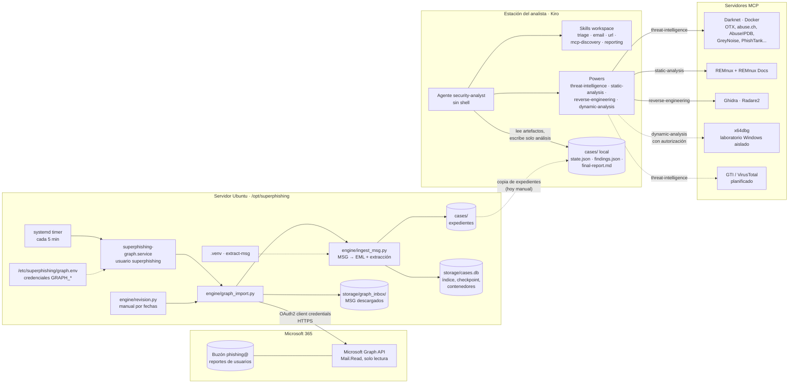
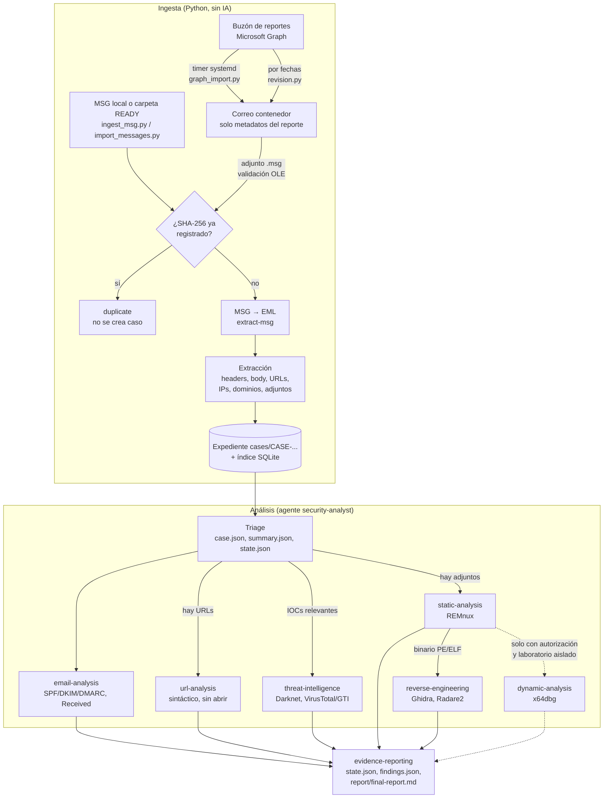

# Security Analysis Pipeline

Proyecto autocontenido de Kiro para procesar e investigar evidencias de seguridad. El diseño prioriza **procesamiento determinístico** y reserva la IA para interpretación, correlación y decisiones que lo requieran.

## Abrir el proyecto

1. Descomprime el ZIP.
2. En Kiro, abre la carpeta `security-analysis-pipeline` con **File → Open Folder**.
3. Selecciona el agente `security-analyst`.
4. Importa una sola vez los cuatro Powers locales desde `powers/*` siguiendo `docs/KIRO-SETUP.md`.

No se instalan herramientas de análisis, binarios ni servidores nuevos. Solo se registran los cuatro paquetes Power locales en Kiro; las conexiones apuntan a los servidores MCP existentes de tu laboratorio.

## Arquitectura



| Componente | Dónde corre | Responsabilidad | Escribe en |
|---|---|---|---|
| `graph_import.py` + timer | Servidor Ubuntu | Sondeo incremental del buzón; solo descarga adjuntos `.msg` | `storage/` |
| `revision.py` | Servidor o estación | Revisión manual por rango de fechas | `storage/` |
| `ingest_msg.py` | Donde se ejecute la ingesta | MSG → EML, extracción, hashes, deduplicación | `cases/`, `storage/cases.db` |
| Agente `security-analyst` | Kiro (estación) | Triage, correlación, veredicto, informe | `analysis/` y `report/` del caso |
| Powers / MCP | Servidores remotos | Reputación, análisis estático, reversing, dinámica | Ninguno en el proyecto |

Hoy la ingesta (servidor) y el análisis (Kiro) no comparten almacenamiento: cada máquina tiene su propio `cases/` y su propia `cases.db`. Para analizar en Kiro expedientes creados en el servidor hay que copiarlos o montar `cases/` compartido.

## Flujo



Las ramas que el triage no justifica quedan como `not_applicable` u omitidas con motivo en `state.json`. El agente reutiliza etapas completadas cuando el fingerprint de su entrada no cambió.

## Diseño de bajo consumo

- Python realiza conversión, parsing, extracción, normalización, hashes y deduplicación sin LLM.
- El agente empieza por `case.json`, `summary.json` y `analysis/state.json`; abre artefactos completos solo cuando una pregunta concreta lo requiere.
- Cinco Skills generales de workspace: triage, email, URL, descubrimiento selectivo MCP e informes.
- Cuatro Powers especializados: CTI, análisis estático, ingeniería inversa y dinámica.
- Un único agente coordinador; sin subagentes ni delegación redundante.
- Cada Power contiene solo los MCP de su especialidad. Kiro administra y activa/desactiva esas conexiones junto al Power.
- El agente usa `includeMcpJson: false` y `includePowers: true`: no importa el inventario MCP global al contexto.
- Las Skills usan carga progresiva: metadatos al inicio y contenido completo bajo demanda.
- Los secretos se suministran mediante variables de entorno aprobadas; no están en el repositorio.
- JSON por expediente para estado/hallazgos; SQLite para índice y deduplicación determinística.
- Shell denegado al agente. Solo puede actualizar estado, hallazgos e informe del caso activo.

## Skills generales

| Skill | Función |
|---|---|
| `triage` | Decide qué ramas aplicar y en qué orden |
| `email-analysis` | Headers, autenticación, MIME y señales de ingeniería social |
| `url-analysis` | Sintaxis, dominios, redirecciones observadas y reputación autorizada |
| `mcp-tool-discovery` | Descubrimiento selectivo de herramientas del Power activo |
| `evidence-reporting` | Tracking de etapas, hallazgos y construcción del informe |

## Powers y servidores MCP

| Power | Servidores | Skill especializada |
|---|---|---|
| `threat-intelligence` | Darknet | `ioc-correlation` |
| `static-analysis` | REMnux + REMnux Docs | `file-analysis` |
| `reverse-engineering` | Ghidra + Radare2 | `reverse-engineering` |
| `dynamic-analysis` | x64dbg | `dynamic-analysis` |

Procmon no aparece en la configuración MCP compartida, por lo que no se anuncia como conectado.

## Configurar Kiro

Sigue `docs/KIRO-SETUP.md` y `docs/MCP-ENVIRONMENT.md`. Las credenciales que se compartieron en la conversación deben rotarse antes del primer uso. Ningún secreto está incluido en este ZIP.

## Preparar un caso desde MSG

### Carpeta creada por el colector

```bash
.venv/bin/python engine/import_messages.py /ruta/a/descargas --recursive --ready-only
```

El motor valida los SHA-256 declarados. Si MSG y EML coinciden con `metadata.json`, reutiliza el EML y evita convertir de nuevo.

### MSG individual

```bash
.venv/bin/python engine/ingest_msg.py /ruta/al/correo.msg
```

Todo el motor se ejecuta dentro del venv del proyecto (`extract-msg` es necesario para convertir un MSG sin EML verificado):

```bash
python3 -m venv .venv
.venv/bin/python -m pip install -r requirements.txt
.venv/bin/python engine/ingest_msg.py /ruta/al/correo.msg
```

### Buzón de reportes vía Microsoft Graph

`engine/graph_import.py` sondea el buzón y crea un expediente por cada adjunto `.msg` (el correo contenedor solo aporta metadatos del reporte). Es incremental: guarda un checkpoint en `storage/cases.db`, omite contenedores ya procesados y reintenta hasta 3 veces los que fallan.

```bash
export GRAPH_TENANT_ID=... GRAPH_CLIENT_ID=... GRAPH_CLIENT_SECRET=... GRAPH_MAILBOX=reportes@dominio
.venv/bin/python engine/graph_import.py            # una pasada
```

En Ubuntu se instala como timer de systemd en `/opt/superphishing`:

```bash
sudo ./deploy/ubuntu/install.sh
sudoedit /etc/superphishing/graph.env             # credenciales GRAPH_*
sudo systemctl start superphishing-graph.service   # prueba manual
journalctl -u superphishing-graph.service -n 50
sudo systemctl enable --now superphishing-graph.timer
```

#### Revisión por fechas

```bash
.venv/bin/python engine/revision.py 09-10                # el día 9 de octubre completo
.venv/bin/python engine/revision.py 09-10 15-10          # del 9 al 15 de octubre, ambos incluidos
.venv/bin/python engine/revision.py --desde 01-11        # del 1 de noviembre hasta ahora
.venv/bin/python engine/revision.py 09-10 --listar       # solo lista, no descarga ni crea casos
```

Fechas en `DD-MM`, `DD-MM-AAAA` o `AAAA-MM-DD`, en hora local del servidor (o `--tz Europe/Madrid`). No altera el checkpoint del timer, omite contenedores ya procesados (`--reprocesar` para revisarlos de nuevo) y nunca duplica expedientes, porque deduplica por SHA-256 del MSG.

El intervalo se define en `OnUnitInactiveSec` de `deploy/ubuntu/superphishing-graph.timer` (5 minutos por defecto).

El motor no usa red, no abre URLs, no ejecuta adjuntos y no invoca IA. Conserva el MSG como evidencia primaria.

## Ejecutar análisis

Una vez creado el expediente, indica al agente:

> Analiza el expediente `CASE-...` ubicado en `cases/CASE-...`.

El agente consulta los resúmenes, ejecuta triage, activa únicamente los Powers justificados, descubre las herramientas MCP pertinentes y reutiliza etapas completadas cuando el fingerprint coincide. El análisis dinámico requiere autorización explícita por muestra y laboratorio aislado.

## Tracking

```text
cases/CASE-.../
├── original/                 # MSG original, inmutable
├── normalized/               # EML, inmutable
├── extracted/                # Headers, URLs, IPs, dominios y adjuntos
├── attachments/              # Adjuntos extraídos, inmutables
├── analysis/
│   ├── state.json            # Estados por etapa y fingerprints
│   └── findings.json         # Hallazgos breves y referencias
└── report/
    └── final-report.md       # Informe final
```

Consulta un expediente con `.venv/bin/python engine/case_cli.py CASE-...`.

## Pruebas

```bash
.venv/bin/python -m unittest discover -s tests -v
```

Las pruebas usan mensajes sintéticos; no ejecutan muestras ni realizan conexiones de red.
