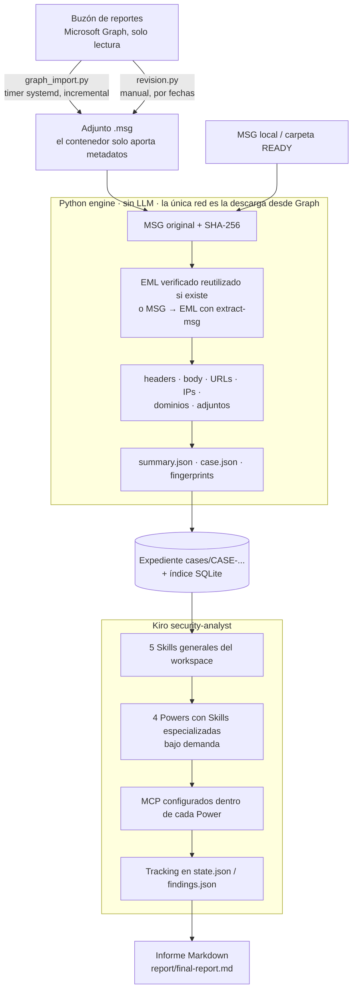

# Arquitectura

## Principio

**Determinístico primero; IA solo para interpretar, correlacionar y decidir.**

El diagrama de componentes y despliegue está en la sección **Arquitectura** del `README.md`. Este muestra el recorrido de un correo.

## Responsabilidades

- `engine/`: parsing, normalización, hashes, extracción, importación y registro determinístico.
- `engine/graph_import.py` y `engine/revision.py`: colector de Microsoft Graph (sondeo incremental y revisión por fechas).
- `deploy/ubuntu/`: servicio y timer systemd, `install.sh` y plantilla de credenciales para el servidor.
- `.kiro/agents/`: un agente coordinador con permisos restringidos.
- `.kiro/skills/`: cinco Skills generales: triage, email, URL, descubrimiento MCP e informe.
- `powers/`: cuatro paquetes Kiro nativos con `plugin.json`, `mcp.json` y una Skill especializada cada uno.
- `.kiro/steering/`: reglas globales breves.
- `.kiro/settings/mcp.json`: deshabilita únicamente las copias globales de los seis servidores recibidos para evitar conexiones duplicadas en este workspace.
- `analysis/state.json`: tracking mutable de etapas y fingerprints.
- `analysis/findings.json`: hallazgos breves con referencias.
- `storage/cases.db`: índice SQLite determinístico.

## Powers y servidores

| Power | Skill | MCP incluidos |
|---|---|---|
| `threat-intelligence` | `ioc-correlation` | Darknet |
| `static-analysis` | `file-analysis` | REMnux, REMnux Docs |
| `reverse-engineering` | `reverse-engineering` | Ghidra, Radare2 |
| `dynamic-analysis` | `dynamic-analysis` | x64dbg |

Procmon queda pendiente porque no aparece en la configuración recibida. No se simula ni se inventa su conexión.

Los Powers empaquetan sus configuraciones MCP en `mcp.json`. Kiro administra y namespacia esas conexiones; los secretos se expanden desde variables de entorno aprobadas y no se guardan en el repositorio.

El agente usa `includePowers: true` y `includeMcpJson: false`. El `mcp.json` del workspace deshabilita las definiciones globales con los mismos nombres, pero no altera el archivo global del usuario ni otros proyectos.

## Ruta de análisis

1. `ingestion` y `extraction`: motor Python sin IA.
2. `triage`: siempre.
3. `url_analysis`: solo si hay URLs.
4. `ioc_analysis`: solo si existen IOC contextuales.
5. `static_analysis`: si hay adjuntos.
6. `reverse_engineering`: solo si existe binario que lo justifique.
7. `dynamic_analysis`: solo tras análisis estático insuficiente, autorización específica y laboratorio aislado confirmado.
8. `report`: desde los hallazgos y referencias persistidos.

No todas las ramas se ejecutan en todos los casos. `not_applicable` y `skipped` son estados válidos.
